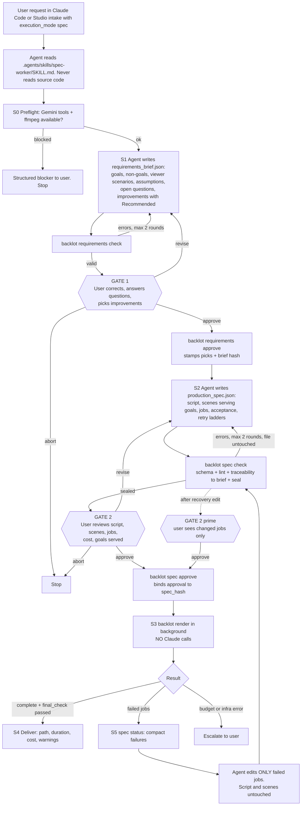
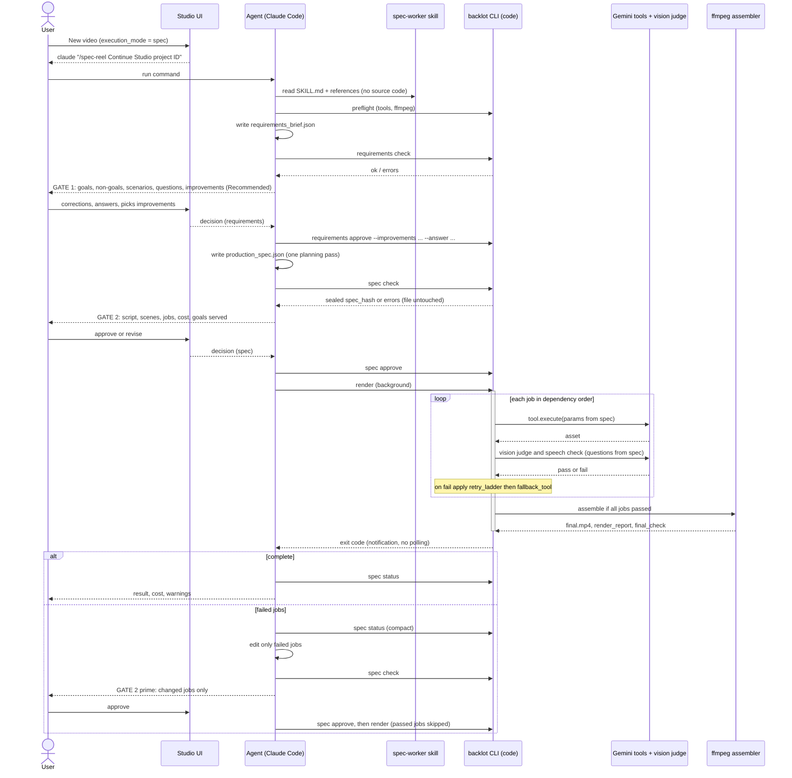

# Spec-mode workflow (agent-driven)

**Status: implemented as instructions** in `.agents/skills/spec-worker/` (entry: `/spec-reel`, routing in `AGENT_GUIDE.md` "Spec Mode"). This page is the review copy: principle, flow diagrams, and the code/instruction split. The skill is the source of truth for agents; keep both in sync.

## Principle

OpenMontage rule (`AGENT_GUIDE.md`): *Python = tools + persistence; the agent is the intelligence; instructions live in skills.*

- **Workflow, creative rules, prompt-writing rules, gates, recovery → `.agents/skills/spec-worker/`.** The agent reads those, never source code.
- **Code only where an agent cannot do the job** without burning Claude tokens or losing determinism: running many Gemini calls, verifying media, assembling with ffmpeg, hashing/linting/approval-binding of artifacts.

Claude plans once (requirements, then spec) and stops spending tokens; the render is a background CLI with no LLM.

## Who does what

| Concern | Owner |
|---|---|
| Requirements brief: goals, non-goals, viewer scenarios, assumptions, questions, improvements + recommendation | **Agent** (every request, small or large) |
| Picking improvements, answering questions, approving each step | **User** (chat now; Studio panels in Phase 5) |
| Idea, script, scenes, shot prompts, acceptance questions, retry ladders | **Agent** |
| Schema, lint, traceability to the approved brief, hashing, approval binding | **Code** (`requirements check/approve`, `spec check/approve`) |
| Generate with Gemini, verify, retry, cost, assemble | **Code** (`render`) |
| Read failures, edit failed jobs, ask re-approval | **Agent** (`references/recovery.md`) |

## Flowchart

## Sequence diagram

## Goals / non-goals of this feature

**Goals**
1. Claude decides everything creative once; the worker executes it with no discretion.
2. Output cannot drift from the plan: sealed spec, verbatim narration, per-job acceptance checks, final check.
3. Every request, however small, is made explicit (goals, non-goals, scenarios) and proven to be answered (traceability lint).
4. The user steers at two ordered gates and picks improvements from recommended options.
5. Claude token use after approval is ~zero on the happy path.
6. Workflow, Studio UI and backend share one file contract (`references/studio-contract.md`).

**Non-goals**
- Replacing the 7-stage pipelines for projects that are not spec-mode.
- Remotion/HyperFrames/atelier compositions (spec-mode assembles with ffmpeg).
- Non-Gemini generation providers in the worker.
- Semantic video review by Claude (the judge is a Gemini vision model answering the spec's own questions).

## Code that exists and why an agent cannot replace it

| Code | Reason |
|---|---|
| `lib/production_spec.py`, `lib/requirements_brief.py` + schemas | Deterministic validation, hashing, traceability; an agent must not self-certify |
| `backlot/spec_cli.py` (`requirements`, `spec`) | Gate commands + compact status so the agent never reads big JSON |
| `lib/spec_executor.py`, `lib/spec_verifier.py` | Hundreds of mechanical generate/verify/retry steps; an agent loop would burn tokens |
| `lib/spec_to_edit.py`, `lib/spec_assembler.py` | Deterministic ffmpeg assembly |

## Reverted (no longer needed)

`lib/planner.py` (Anthropic API planner), the `plan` CLI, the `anthropic` dependency in `requirements.txt`, and the planner tests. The planner prompt rules now live in `.agents/skills/spec-worker/references/`. The Phase 5 "replan" code was never written; recovery is an agent procedure (`references/recovery.md`).
