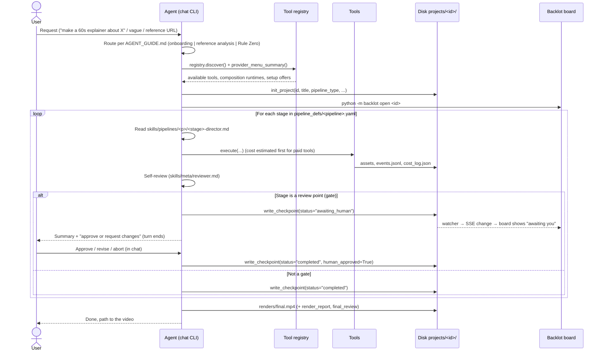

# 01 — Current System (As-Is)

> **Note (Phase F, 2026-11-13):** the classic board (`backlot/ui/`) was removed. `/` and `/p/<id>` now redirect to Studio, and mentions of the classic board or `board.css` below describe the state at the time of writing. See [STATUS.md](STATUS.md#phase-f--remove-the-classic-board--done).

This document records how OpenMontage produces a video today. Every claim points to the file it was verified against. The UI must fit this workflow, not replace it.

## 1. The one fact that shapes the UI

**No Python orchestrator runs the pipeline. The agent runs it.**

`PROJECT_CONTEXT.md` says: *"No Python orchestrator, no Python reviewer, no Python handlers. The agent drives the pipeline."* Python supplies three things:

- **Tools.** `tools/` holds 100+ `BaseTool` subclasses, discovered by `tools/tool_registry.py`.
- **Persistence and enforcement.** `lib/checkpoint.py` and `lib/pipeline_loader.py`.
- **Observation.** `backlot/` is a read-only live board.

The creative loop — choosing concepts, writing scripts, picking providers, reviewing output — lives in Markdown skills:

- `AGENT_GUIDE.md`: routing rules and hard rules
- `skills/pipelines/<pipeline>/<stage>-director.md`: per-stage instructions
- `skills/meta/*.md`: onboarding, reviewer, checkpoint protocol, and so on

A coding agent follows these skills inside a chat session.

**Consequence.** A UI cannot "press Run". It either drives an agent or works alongside one. Studio works alongside one (see `03-architecture.md`).

## 2. Actors

| Actor | Role | Where |
|---|---|---|
| User | Gives the brief; approves or rejects at review points | Chat CLI |
| Agent | Routes, plans, calls tools, self-reviews, writes checkpoints | Claude Code / Codex / Cursor session |
| Tools | Do the actual work: TTS, image/video generation, compose, analysis | `tools/**`, `BaseTool.execute(inputs) -> ToolResult` |
| Disk | Single source of truth for a production | `projects/<project-id>/` |
| Backlot | Read-only board that derives everything from disk and pushes changes over SSE | `backlot/server.py`, `backlot/state.py`, `backlot/ui/` |

## 3. End-to-end workflow

### 3.1 Routing (`AGENT_GUIDE.md`)

- **Vague first message** ("what can you do?"): the agent reads `skills/meta/onboarding.md` and runs onboarding. That means a preflight, a setup tier, 3 starter prompts per tier, and 2 reference-based prompts.
- **Reference video** (a URL or local file sent as inspiration): the agent reads `skills/meta/video-reference-analyst.md`. It analyses the video with `video_analyzer`, transcripts and scene detection, then picks a pipeline.
- **Specific request:** **Rule Zero** applies. All production goes through a pipeline, and ad-hoc scripts are forbidden.
- `.claude/commands/reel.md` (`/reel <request>`) is a thin wrapper that tells the agent to follow `AGENT_GUIDE.md`.

### 3.2 Preflight (`tools/tool_registry.py`)

`registry.provider_menu_summary()` returns:

- `composition_runtimes`: `{ffmpeg, remotion, hyperframes}` as booleans
- `capabilities[]`: per capability, the configured and available providers
- `setup_offers[]`: tools that one env var would unlock, with `install_instructions` and `env_vars`
- `runtime_warnings[]`: messages the agent must show the user verbatim

`registry.provider_menu()` is the full version. `make preflight` prints it.

### 3.3 Stages and artifacts

Most pipelines follow one of two shapes. Gated stages (review points) are marked with ★.

| Shape | Pipelines | Stages |
|---|---|---|
| Research-first | animated-explainer, animation, cinematic | research → proposal★ → script★ → scene_plan★ → assets★ → edit → compose → publish★ |
| Research-first + character | character-animation (beta) | research → proposal★ → script★ → character_design★ → rig_plan → scene_plan★ → assets★ → edit → compose → publish★ |
| Idea-first | avatar-spokesperson, hybrid, screen-demo, talking-head (beta), clip-factory (beta), podcast-repurpose (beta), localization-dub (beta) | idea★ → script★ → scene_plan★ → assets★ → edit → compose → publish★ |
| Montage | documentary-montage (beta) | idea★ → scene_plan★ → assets★ → edit★ → compose |

`framework-smoke` is a test pipeline and is never shown to users.

| Stage | Artifact | Schema | Key content |
|---|---|---|---|
| research | `research_brief` | `schemas/artifacts/research_brief.schema.json` | topic, data_points, angles_discovered, sources |
| idea | `brief` | `brief.schema.json` | title, hook, key_points, tone, style, target_platform, target_duration_seconds |
| proposal | `proposal_packet` + `decision_log` | `proposal_packet.schema.json` | concept_options, selected_concept, production_plan (render_runtime, composition_mode, music_source), cost_estimate, approval{status, user_notes, approved_budget_usd} |
| script | `script` | `script.schema.json` | sections, voice_performance |
| scene_plan | `scene_plan` | `scene_plan.schema.json` | scenes, style_playbook |
| assets | `asset_manifest` | `asset_manifest.schema.json` | assets, total_cost_usd |
| edit | `edit_decisions` | `edit_decisions.schema.json` | cuts, overlays, audio, subtitles, music, **render_runtime** |
| compose | `render_report` + `final_review` | `render_report.schema.json`, `final_review.schema.json` | outputs (final video paths), final QA |
| publish | `publish_log` | `publish_log.schema.json` | entries |

### 3.4 Review points (gates)

- **Source of truth.** The `human_approval_default: true` setting on each stage in the pipeline manifest decides which stages gate.
- **Enforcement in code** (`lib/checkpoint.py`):
  - `write_checkpoint` raises **GATE VIOLATION** if a gated stage is written as `completed` without `human_approved=True`.
  - `_enforce_stage_prerequisites` raises **PREREQUISITE VIOLATION** if a stage advances before all earlier stages are completed and approved.
  - Proposal approval also requires `proposal_packet.approval.status` to be approved.
- **Protocol** (`skills/meta/checkpoint-protocol.md`, Step 5):
  1. The agent writes `awaiting_human`.
  2. It presents a summary covering the artifact, review findings and cost.
  3. It **ends its turn**.
  4. The user's reply decides the outcome: approve, revise (re-run the stage with feedback; the old checkpoint is archived to `history/`), or abort.
  5. Approval is **per gate**. Blanket pre-approval only counts if it was logged as a `decision_log` entry with `category: "approval_policy"`.
- **The assets gate** reviews the storyboard: per-scene assets and `snapshots/<scene_id>.png`. It happens **before** any draft render.

### 3.5 Choices the user must make (proposal stage)

`AGENT_GUIDE.md` and the director skills require the agent to ask for:

| Choice | Rule |
|---|---|
| Concept | Pick 1 of 3–5 `concept_options` |
| Budget | `cost_estimate` vs `config.yaml` `budget.total_usd` (default $10, mode `warn`) |
| Render runtime | **Hard rule:** if both Remotion and HyperFrames are available, both must be presented; silently picking a default is forbidden |
| Composition mode | Templated (fast, reliable) vs atelier (bespoke) |
| Music | User library (`music_library/`), generated, or none |
| Voice / provider / model | Announce before any paid call; any later swap or fallback needs approval and a new `decision_log` entry |

### 3.6 Inputs and outputs

**Inputs**
- A text brief: topic, platform, duration, tone.
- An optional reference video (URL or file).
- Source footage for the footage-led pipelines: talking-head, clip-factory, podcast-repurpose, localization-dub, hybrid.
- Music in `music_library/`.
- API keys in `.env`, loaded by `lib/env_loader.py` during `registry.discover()`.
- A style playbook from `styles/*.yaml`: anime-ghibli, clean-professional, flat-motion-graphics, minimalist-diagram, premium-minimalist.
- `config.yaml`: LLM, budget, checkpoint policy, output format.

**Outputs**
- `projects/<id>/renders/final.mp4`
- Intermediate assets under `assets/`
- An optional `export_bundle` at publish
- Zero-key demos written to `projects/demos/renders/` by `render_demo.py`

### 3.7 Disk contract (`projects/<project-id>/`)

| File / dir | Written by | Read by Backlot |
|---|---|---|
| `project.json` | `init_project()` | title, pipeline_type, series, style_playbook |
| `checkpoint_<stage>.json`, `history/` | `write_checkpoint()` | stage status, review, cost_snapshot, human_approved |
| `artifacts/*.json` | agent | script, scene plan, storyboard, … |
| `decision_log.json` | agent (append-only) | Decisions panel |
| `events.jsonl` | `lib/events.py`, via `BaseTool` instrumentation | activity feed, "generating" state |
| `cost_log.json` | `tools/cost_tracker.py` (`CostTracker`) | cost (via checkpoint `cost_snapshot`) |
| `assets/{images,video,audio,music}/`, `snapshots/`, `renders/` | tools | filmstrip, media, renders |

## 4. Backlot today

**Server.** `backlot/server.py` (FastAPI) runs on `127.0.0.1:4750` (override with `BACKLOT_PORT`).
- `TrustedHostMiddleware` allows localhost only.
- `watchfiles` watches `projects/`, and a `ChangeHub` fans each change out over SSE.

| Route | Purpose |
|---|---|
| `GET /api/health` | liveness |
| `GET /api/projects` | library summaries (`state.list_projects`) |
| `GET /api/project/{id}/state` | full board state (`state.load_board_state`) |
| `GET /api/project/{id}/events` | SSE: hello / change / heartbeat |
| `GET /api/library/events` | SSE for all projects |
| `GET /thumb/{id}/{path}?w=` | cached JPEG thumbnail |
| `GET /media/{id}/{path}` | raw media with range support; rejects paths that escape the project (403) |
| `GET /`, `/p/{id}` | vanilla-JS library and board pages (`backlot/ui/`) |

**Views.** Library (project cards, series), and a board with:
- stage rail and drawers
- approval review panel
- script and screenplay
- storyboard filmstrip
- Decisions panel and activity feed
- renders
- replay scrubber
- light/dark theme

**Interaction.** The board is **read-only by design.** At a gate it says *"reply in chat to approve or request changes."*

**Tests.** `tests/backlot/` covers server, state, gate scenarios and Playwright `test_ui_bug_bash.py`. There is also `tests/contracts/test_backlot_contract.py`.

## 5. Gaps a newcomer hits today

| # | Gap | Effect on a newcomer |
|---|---|---|
| G1 | Everything starts in a terminal chat | Intimidating; requires installing and knowing an agent CLI |
| G2 | No view of what works on this machine (keys, runtimes, GPU) | Doesn't know what they can make or what one key would unlock |
| G3 | 13 pipelines, named in engine terms | Can't pick the right one; doesn't know which need their own footage |
| G4 | No structured brief | The quality of the result depends on prompt-writing skill |
| G5 | Approval only by typing in chat | Easy to miss a review point; no side-by-side review |
| G6 | No uploads | Footage-led pipelines need manual file placement |
| G7 | Cost is visible only inside checkpoints | No clear "spent / remaining" view or budget control |
| G8 | No project-creation, pipeline-catalog, setup or write API | The UI has nothing to build on beyond the read-only board |
| G9 | Localhost only, no auth | Fine for v1; blocks hosted multi-user later |
