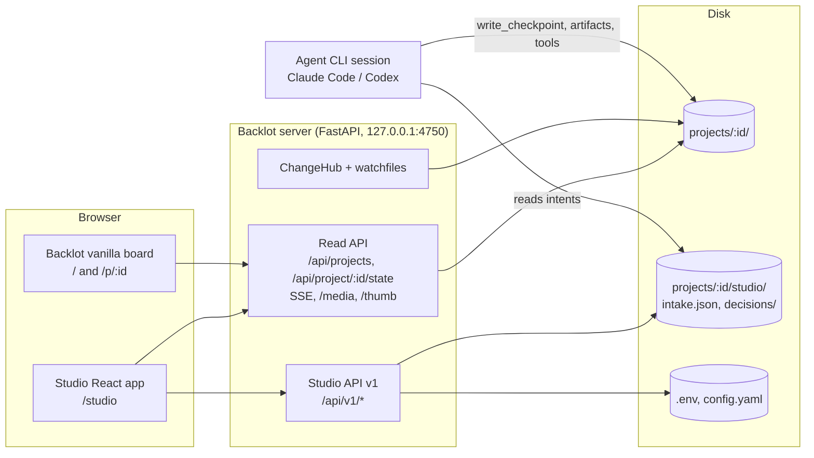

# 03 — Architecture

## 1. Principle: companion, not controller

The agent stays the **only** process that advances a production and the **only** writer of checkpoints and artifacts. Studio adds a second input channel next to the chat: structured **intents** written to disk. The agent reads and applies them under the same rules it uses for chat replies.

This keeps three guarantees:

- **Gate enforcement still works.** `lib/checkpoint.py` raises GATE VIOLATION and PREREQUISITE VIOLATION exactly as before, because only the agent calls `write_checkpoint`.
- **The audit trail stays whole.** Every Studio decision becomes a `decision_log` entry, written by the agent.
- **The agent never acts on state it didn't write.** No race between UI writes and agent writes on the same file.

## 2. Topology (local, v1)



- **Studio app.** `studio/` is a React + Vite + TailwindCSS project.
  - In production its build output (`studio/dist/`) is served by the Backlot server under `/studio`.
  - In development, Vite runs on its own port and proxies `/api`, `/media` and `/thumb` to `:4750`.
- **Read side.** The existing Backlot routes are reused unchanged. `backlot/state.py` stays pure and read-only.
- **Write side.** A new FastAPI router `backlot/studio_api.py` is mounted at `/api/v1`. All write logic lives there, so the read-only modules keep their contract and tests.
- **Vanilla Backlot board.** It stays available until Studio reaches parity (Phase 1) and beyond. Retiring it is a separate decision.

## 3. Studio ↔ agent disk contract

All Studio-owned files live under `projects/<id>/studio/`. This is a new directory that the agent reads and never deletes.

```
projects/<id>/studio/
  intake.json                       # written by the wizard (Phase 3), editable until the first checkpoint
  inputs.json                       # index of uploaded files + reference links (Phase 5, §3.5)
  decisions/
    <id>.json                       # one file per decision (Phase 4); id = YYYYMMDDTHHMMSSZ-<stage>-<hex6>
    <id>.consumed.json              # renamed by `python -m backlot consume-decision` after the agent applies it
```

Uploaded media goes to `projects/<id>/inputs/`, next to `assets/` and not inside `studio/`, so pipelines treat it as source material.

### 3.1 `intake.json` (v1)

```json
{
  "schema": "studio.intake/1",
  "created_at": "2026-11-10T12:00:00Z",
  "updated_at": "2026-11-10T12:00:00Z",
  "title": "How black holes form",
  "goal": "explain-topic",
  "pipeline_type": "animated-explainer",
  "brief": {
    "topic": "How black holes form",
    "audience": "high-school students",
    "platform": "shorts",
    "aspect": "9:16",
    "duration_seconds": 60,
    "tone": "Friendly, Clear",
    "must_include": ["event horizon"],
    "avoid": [],
    "target_languages": []
  },
  "style_playbook": "clean-professional",
  "budget": { "cap_usd": 2.0, "mode": "cap" },
  "reference": { "url": null, "notes": null },
  "advanced": {
    "render_runtime_preference": null,
    "composition_mode_preference": null,
    "checkpoint_policy": "guided",
    "production_mode": null
  },
  "music_track": null,
  "language": "en"
}
```

- `platform` is one of `youtube`, `shorts` (Shorts/Reels/TikTok), `linkedin`, `other`; `aspect` follows it.
- `goal` is the wizard goal id (`studio/src/content/goals.ts`), or `like-this` for the reference-driven entry.
- `budget.cap_usd` is `0` on a Zero-key machine ("Free — runs locally").
- `advanced.production_mode` is only set for pipelines that declare `production_modes` (screen-demo).
- `brief.target_languages` is only filled for localization-dub (Phase 5).
- `music_track` is a track name from the music library (`GET /api/v1/music`), or `null` (Phase 5).
- The server-side model is `IntakeIn` in `backlot/studio_catalog.py`.

**Preferences are not decisions.** `render_runtime_preference` is a hint. The agent still presents both runtimes at the proposal step (hard rule in `AGENT_GUIDE.md`) and records the user's real pick from the proposal decision.

### 3.2 Decision file (v1)

```json
{
  "schema": "studio.decision/1",
  "id": "20261110T123000Z-script-a1b2c3",
  "created_at": "2026-11-10T12:30:00Z",
  "stage": "script",
  "checkpoint_timestamp": "2026-11-10T12:28:41Z",
  "action": "approve",
  "notes": "",
  "proposal": null,
  "source": "studio",
  "user": "local"
}
```

- **`action`** is one of `approve`, `revise`, or `abort`.
- **`checkpoint_timestamp`** ties the decision to the exact `awaiting_human` checkpoint the user saw. If the agent has since rewritten that checkpoint, the decision is stale: the agent ignores it and Studio shows "the step changed — review again".
- **At the proposal step**, `proposal` carries the picks:

  ```json
  { "selected_concept_id": "c2", "approved_budget_usd": 2.0,
    "render_runtime": "hyperframes", "composition_mode": "templated",
    "music_source": "user_library", "music_track": "calm_piano.mp3", "voice": null }
  ```

  `music_source` is one of `user_library`, `ai_generated`, `bring_your_own`, `none`. `music_track` is only set with `user_library`. The model is `ProposalPicks` in `backlot/studio_decisions.py`.
- **The API lists decisions with a derived `state`:** `pending`, `consumed`, or `stale` (the checkpoint moved on).

### 3.3 Agent-side changes (Phase 3–5) — shipped

The live wording is in `AGENT_GUIDE.md` "Projects Created in Studio" and `skills/meta/checkpoint-protocol.md` Step 5.7. The plan below is kept for history: `await-decision` shipped together with `consume-decision`, and Phase 5 added source media (§3.5).

1. **`AGENT_GUIDE.md`, new section "Studio intents".**
   - **At kickoff:** if `projects/<id>/studio/intake.json` exists, treat it as the brief. Don't re-ask answered questions, and log the intake as the first `decision_log` entry. *(Shipped in Phase 3 as the "Projects Created in Studio" section.)*
   - **At every gate,** after writing `awaiting_human`, check for an unconsumed decision for this stage whose `checkpoint_timestamp` matches. Apply it exactly like a chat reply:
     - `approve`: `write_checkpoint(..., status="completed", human_approved=True)`
     - `revise`: re-run the director skill with the notes
     - `abort`: stop
   - **After applying:** log the decision to `decision_log` with `source: "studio"`, then mark the file consumed.
2. **`skills/meta/checkpoint-protocol.md`, Step 5.** A Studio decision counts as "the user's reply". The *end your turn* rule is unchanged. The agent waits through one of the mechanisms below.
3. **Waiting mechanism.** Add `python -m backlot await-decision <id> <stage> [--timeout N]` to `backlot/__main__.py`.
   - It blocks until a matching decision file appears, then prints it as JSON and exits 0. On timeout it exits non-zero.
   - The agent runs it as a background command when it stops at a gate. When it returns, the agent resumes; the user doesn't have to type anything.
   - **Fallback:** the user types `/studio-continue <id>` (a new `.claude/commands/studio-continue.md`) or "continue" in chat, and the agent reads pending decisions.
4. **Kickoff command shown by the wizard:** `claude "/reel Continue Studio project <id>"`. The `/reel` command already defers to `AGENT_GUIDE.md`, which now knows about `studio/intake.json`.

### 3.4 Why not have Studio write checkpoints directly?

Studio could call `write_checkpoint(..., human_approved=True)` itself, but:
- the agent would not notice, because its turn has ended;
- it would skip the agent's `decision_log` entry and revision handling;
- it would create two writers of the same file.

The intent-file design costs one extra hop but preserves every existing guarantee.

### 3.5 `inputs.json` (v1, Phase 5)

```json
{
  "schema": "studio.inputs/1",
  "files": [
    { "path": "inputs/talk.mp4", "name": "talk.mp4", "kind": "footage", "media": "video",
      "size": 95716, "duration_s": 6.0, "width": 640, "height": 360, "codec": "h264",
      "uploaded_at": "2026-11-10T10:21:02Z" }
  ],
  "references": [
    { "id": "a1b2c3d4", "url": "https://youtu.be/…", "notes": "the pacing",
      "added_at": "2026-11-10T10:22:00Z", "source": "studio" }
  ],
  "updated_at": "2026-11-10T10:22:00Z"
}
```

- **`kind`** is `footage` or `reference`; a reference file is a video to study, not to edit.
- **`media`** is `video`, `audio`, `image` or `subtitle`, decided by the extension allowlist.
- **ffprobe fields** are `null` when ffprobe can't read the file.
- **`source`** is `wizard` for the link given in "make something like this", and `studio` for links added on the project page.
- **The agent never edits this file.** It reads it at kickoff, uses `inputs/*` as source media, and runs the reference-analysis flow for `references[]`. That flow saves `artifacts/video_analysis_brief.json`, which Studio shows at the first review point.
- The code is in `backlot/studio_uploads.py`.

## 4. Studio API v1

All routes are mounted at `/api/v1` by `backlot/studio_api.py`. Reads reuse existing helpers wherever possible.

| Method & path | Phase | Purpose | Reuses |
|---|---|---|---|
| `GET /api/v1/session` | 0 | Returns CSRF token, server version, feature flags | — |
| `GET /api/v1/pipelines` | 3 | Video types: name, description, stability, stages (with gated flag), reference support, needs-footage flag | `lib/pipeline_loader.list_pipelines`, `load_pipeline`, `get_stage_human_approval_default` |
| `GET /api/v1/styles` | 3 | Style playbooks (name, description, preview) | `styles/*.yaml`, `styles/playbook_loader.py` |
| `GET /api/v1/setup` | 2 | Tier, works-now, unlock offers, runtimes, warnings | `registry.provider_menu_summary()` |
| `POST /api/v1/setup/recheck` | 2 | Re-run discovery after a key change | `registry.discover()` (fresh process or reset) |
| `PUT /api/v1/setup/env` | 2 | Set or replace allowlisted env vars in `.env`; values never echoed back | allowlist = `env:` dependencies of registered tools |
| `GET /api/v1/demos` / `POST /api/v1/demos/{name}/render` | 3 | List and render zero-key demos as a background job | `render_demo.py` |
| `GET /api/v1/jobs/{id}` | 3 | Background job status (demo renders, re-checks) | in-process job table |
| `POST /api/v1/projects` | 3 | Create a project: `init_project()` + write `studio/intake.json` | `lib/checkpoint.init_project` |
| `PATCH /api/v1/projects/{id}/intake` | 3 | Edit the intake until the agent consumes it | — |
| `GET /api/v1/projects/{id}/kickoff` | 3 | Kickoff command strings for supported CLIs | — |
| `GET /api/v1/projects/{id}/intake` | 3 | Read the intake plus whether it is still editable | — |
| `GET /api/v1/projects/{id}/decisions` | 4 | Pending and consumed decisions | — |
| `POST /api/v1/projects/{id}/decisions` | 4 | Record a decision; validates the stage is `awaiting_human` and the timestamp matches | `lib/checkpoint.read_checkpoint` |
| `DELETE /api/v1/projects/{id}/decisions/{did}` | 4 | Retract a pending decision | — |
| `GET /api/v1/uploads/limits` | 5 | Max size and the extension allowlist per media kind | — |
| `GET /api/v1/projects/{id}/inputs` | 5 | `inputs.json` (existing files only) plus `started` | — |
| `POST /api/v1/projects/{id}/uploads?name=&kind=` | 5 | Raw-body streamed upload to `inputs/` (413 / 415 / 400 `bad_name`) | `/media`-style `relative_to` guard |
| `DELETE /api/v1/projects/{id}/uploads/{name}` | 5 | Remove an upload before the first checkpoint | — |
| `POST /api/v1/projects/{id}/references` / `DELETE …/{ref_id}` | 5 | Add or remove a reference link (http(s) only, never fetched) | — |
| `GET /api/v1/music`, `POST /api/v1/music?name=`, `GET /api/v1/music/tracks/{name}` | 5 | List, upload and preview music-library tracks | `MUSIC_LIBRARY_DIR` resolution of `tools/audio/music_library.py` |
| `GET /api/v1/projects/{id}/results` | 6 | Render variants with facts, copy-ready publish text, export info | `render_report`, `publish_log`, ffprobe |
| `GET /api/v1/projects/{id}/export` | 6 | The exported file, or a zip of the export folder | `publish_log.entries[].export_path` |
| `GET /media/{id}/{path}?download=1` | 6 | Same file, sent as an attachment | existing `/media` guard |
| `GET /api/v1/projects/{id}/cost` | 6 | Snapshot, by tool, by step, by status, entries | `tools/cost_tracker.py` (`cost_log.json`, `cost_snapshot`) |
| `GET /api/v1/cost/summary?since=` | 6 | Money spent across projects since a date (Library month total) | `cost_log.json` |
| `GET/PUT /api/v1/settings` | 6 | Budget, checkpoint policy, output defaults (allowlisted keys, comments kept) | `config.yaml`, `lib/config_model.py` |

Studio's own writes under `studio/` already trigger the existing watcher. That gives Studio live updates for free: the agent's consumption of a decision shows up on screen with no extra plumbing.

## 5. Security (local v1)

| Concern | Control |
|---|---|
| Remote access | Keep the `127.0.0.1` bind and `TrustedHostMiddleware`. Studio stays localhost-only; hosted controls are designed in `hosted/threat-model.md`. |
| CSRF from other local sites | Every non-GET request needs an `X-Studio-Token` header from `GET /api/v1/session` and a same-origin `Origin`. |
| Path traversal | Project ids validated by `_safe_project_dir`. Upload and intake paths are resolved and checked with `relative_to(project_dir)`, as `/media` does. |
| Secret handling | `PUT /setup/env` accepts only keys that a registered tool declares as an `env:` dependency. Values are write-only (the UI shows "set ••••1234"). `.env` is rewritten atomically. Values are never logged or returned. |
| Upload abuse | Size cap (`STUDIO_MAX_UPLOAD_MB`, default 8192), extension and MIME allowlist (video/audio/image/subtitle), raw body streamed to a partial file and renamed when complete, plain file names only (no `/`, `\`, NUL, drive letters). |
| Agent safety | Decisions are bound to a checkpoint timestamp. The agent ignores stale or unknown actions. |

## 6. Frontend stack

| Concern | Choice |
|---|---|
| Build | Vite + React 19 + TypeScript |
| Styling | TailwindCSS. Design tokens (colours, radii, type scale) taken from `backlot/ui/board.css` so both UIs look like one product; light and dark themes. |
| Routing | React Router (`/studio`, `/studio/new`, `/studio/library`, `/studio/p/:id`, `/studio/setup`, `/studio/settings`) |
| Server state | TanStack Query; SSE events invalidate queries (same pattern as `backlot/ui/lib.js` `subscribe`) |
| Forms | React Hook Form + Zod, with schemas mirroring `studio.intake/1` and `studio.decision/1` |
| Video preview | Native `<video>` against `/media`. `@remotion/player` is optional later. |
| Testing | Vitest + Testing Library (unit), Playwright (e2e; reuses the `tests/backlot/test_ui_bug_bash.py` approach) |
| Layout | `studio/src/{app,routes,components/{ui,layout},features/<area>,services,hooks/api,types/api,utils,content/goals.ts}` (since Phase D.5; see `design/ui-refresh.md` §B.1) |

## 7. Hosted path (Phase 7, design only)

The v1 choices are made so hosting later is an addition, not a rewrite. The full design is in [`hosted/design.md`](hosted/design.md), the connector protocol in [`hosted/sync-protocol.md`](hosted/sync-protocol.md), and the risks in [`hosted/threat-model.md`](hosted/threat-model.md). What exists in code today:

- **Two filesystem seams.**
  - `backlot/project_store.py`: `ProjectStore` plus a per-project `ProjectFiles` handle, `DiskProjectStore`, and an `ObjectProjectStore` stub.
  - `backlot/machine_store.py`: `config.yaml`, `.env`, `music_library/`, demos and ffprobe.
  - `tests/contracts/test_studio_store_contract.py` fails if any v1 module touches the filesystem directly.
- **Auth seams.**
  - `current_user` is a router-level dependency on every v1 route.
  - Every project route resolves its project through `project_access("view"|"edit")`, which calls `authorize(user, project_id, access)`.
  - Unknown and forbidden projects both answer 404.

The original plan, kept for reference:

- **`ProjectStore` interface.** Studio API code reads and writes through it, never through `Path` directly. v1 is `DiskProjectStore`; later an object-storage plus metadata-DB store.
- **Auth seam.** All `/api/v1` routes depend on a `current_user` dependency. In v1 it always returns the local user. Hosted mode swaps in real auth (OIDC/session) and per-user project namespaces.
- **Sync connector.** In hosted mode the agent still runs on the user's machine. A small `openmontage sync` process:
  - pushes `projects/<id>/` changes (checkpoints, artifacts, media) to the server;
  - pulls `studio/intake.json` and `studio/decisions/*` back to local disk.

  The disk contract in section 3 is the sync protocol; nothing new is invented.
- **Secrets.** In hosted mode, API keys stay on the user's machine (`.env`). The server never holds provider keys, and the Setup center shows the capability report pushed by the connector.

## 8. Localization (en, vi)

Studio ships in English and Vietnamese. Every phase from Phase 4 on must keep both complete.

- **Catalogs.** `studio/src/i18n/en.ts` is the source; `vi.ts` is typed as `Messages`, so a missing key fails the typecheck. `i18n.test.tsx` also compares every nested key, including label maps, and rejects empty strings. Text with parameters is a function, e.g. `steps: (done, total) => …`; there is no string templating at runtime.
- **Locale.** `localStorage["studio.locale"]` holds the user's choice, set from the header picker or Settings. Without it, the browser language is used (`vi*` → `vi`, otherwise `en`). `<html lang>` follows the locale, and a change in another tab is picked up.
- **How code reads strings.**
  - Components call `useT()`, which re-renders them on a language change.
  - Helpers that run during render (adapters, formatters, label lookups) call `msg()`.
  - Zod schemas use catalog *keys* as messages (`wizard.errors`), resolved with `errorText()`.
- **What is translated.**
  - All UI chrome.
  - Plain-language labels: steps, statuses, video types, capabilities, setup tiers, goals with their examples, tones, platform names, kickoff notes, demo descriptions.
  - Relative times.
- **What is not translated, because it is data:**
  - project titles, briefs, scripts, decision text written by the agent
  - tool `install_instructions` and runtime warnings from the registry
  - style playbook descriptions, file names, CLI commands
  - API error `detail` strings, except where the UI maps a status code to its own message (e.g. 409 on create)
- **Agent-facing files stay language-neutral.**
  - Enum-like values written to disk use English or ids. Example: `brief.tone` in `intake.json` is written with the English tone labels, whatever the UI language.
  - The user's free text is stored as typed.
  - `intake.language` (the narration language) defaults to the UI locale but is a separate choice.
  - The kickoff command stays in English (`Continue Studio project <id>`) because the agent instructions match on it.
- **New API errors meant for display** should carry a stable `code` next to `detail`, so the UI can translate them. Existing endpoints keep `detail` only.

