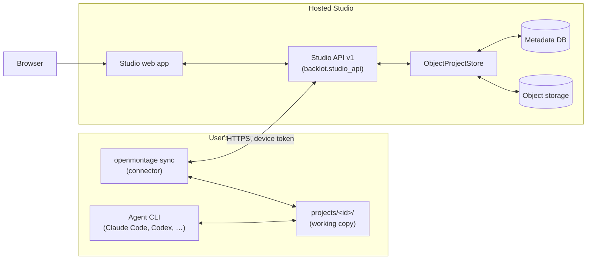

# Hosted Studio — Design

**Status:** design and interfaces only (Phase 7). Nothing here is deployed. A maintainer must review this document, `threat-model.md` and `sync-protocol.md` before any hosted implementation starts.

**Goal.** Run Studio as a multi-user web service while the agent keeps running on each user's own machine. Phases 0–6 should need no rewrite: the hosted service swaps implementations behind seams that already exist and are enforced by tests.

## 1. Shape of the system

- **The agent is unchanged.** It reads and writes `projects/<id>/` on the user's machine, exactly as in local mode (`03-architecture.md` §3).
- **The connector** (`openmontage sync`) mirrors that folder to the service and brings Studio's intents back. The protocol is in `sync-protocol.md`.
- **The hosted API** is the same `backlot/studio_api.py` router. Only its dependencies change:

| Seam (code) | Local implementation | Hosted implementation |
|---|---|---|
| `current_user` (`backlot/studio_api.py`) | always `LOCAL_USER` | session cookie → user (§2) |
| `authorize(user, project_id, access)` | always `True` | owner / viewer rules (§2.3) |
| `get_store` → `ProjectStore` | `DiskProjectStore(projects/)` | `ObjectProjectStore(tenant, bucket, db)` (§3) |
| `backlot/machine_store.py` | `config.yaml`, `.env`, `music_library/`, ffprobe on this machine | per-user settings in the DB; keys, binaries and music stay on the user's machine (§5) |
| `/media`, `/thumb` (`backlot/server.py`) | files under `projects/` | signed object-storage URLs (§3.3) |
| CSRF token (`app.state.studio_token`) | one random token per server process | bound to the session (§2.2) |
| `ALLOWED_HOSTS` / `TrustedHostMiddleware` | `127.0.0.1`, `localhost` | configured service host names (§2.2) |

**Enforced today.** `tests/contracts/test_studio_store_contract.py` proves that:
- no v1 module touches the filesystem except through the two store modules;
- every v1 route depends on `current_user`;
- every project route goes through `project_access` (which calls `authorize`).

**Non-goals for the first hosted version:**
- server-side rendering or generation;
- running the agent in the cloud;
- real-time co-editing;
- billing.

## 2. Identity and access

### 2.1 Sign-in

- **OIDC authorization-code flow with PKCE.** Providers: Google and GitHub first, plus any standards-compliant IdP.
- The service keeps its own `users` table: `id`, `email`, `display_name`, `locale`, `created_at`. It is keyed by `(issuer, subject)`, never by e-mail alone.
- **Sessions:**
  - stored server-side;
  - cookie `__Host-studio_session`: `Secure`, `HttpOnly`, `SameSite=Lax`, 14-day sliding expiry;
  - rotated on sign-in;
  - revocable from the account page.
- `current_user` reads the cookie and returns `User(id, display_name)`. With no session it raises `401 {code: "signed_out"}`, and the UI sends the user to sign-in.

### 2.2 Request protection

- **CSRF:**
  - The token is derived per session (`HMAC(server_key, session_id)`) and returned by `GET /api/v1/session` as today.
  - The existing middleware already rejects non-GET `/api/v1` requests without a matching `X-Studio-Token` and a same-site `Origin`. The only changes are where the token comes from and that `ALLOWED_HOSTS` becomes configuration.
- **Hosts:**
  - `TrustedHostMiddleware` and `ALLOWED_HOSTS` read `STUDIO_ALLOWED_HOSTS` (comma-separated).
  - The local default stays `127.0.0.1,localhost`.
  - Hosted mode refuses to start if it is unset.
- **CORS:** none. The UI is served from the same origin as the API.

### 2.3 Tenants and roles

- **Tenancy.** A *tenant* is a user's workspace; v1 has one tenant per user. Every row and object key carries `tenant_id`.
- **Isolation:**
  - Object keys are `t/<tenant_id>/p/<project_id>/<relative path>`.
  - Project ids stay human-readable slugs, but are unique only within a tenant.
- **Roles per project:**
  - `owner`: everything.
  - `viewer`: read-only, for sharing a cut for feedback.
- **Rule:** `authorize(user, project_id, "view")` passes for owners and viewers; `"edit"` passes for owners only.
- **Hiding other projects.** A project the user may not see answers exactly like an unknown project (404, same body), so project ids never leak across tenants. This is already implemented and tested.

| Route (prefix `/api/v1`) | Access |
|---|---|
| `GET /projects/{id}/intake`, `/kickoff`, `/decisions`, `/inputs`, `/results`, `/export`, `/cost` | view |
| `PATCH /projects/{id}/intake`; `POST`/`DELETE /projects/{id}/decisions…`; `POST /projects/{id}/uploads`, `DELETE …/uploads/{name}`; `POST`/`DELETE /projects/{id}/references…` | edit |
| `POST /projects` | any signed-in user (creates a project they own) |
| `/session`, `/jobs/{id}`, `/pipelines`, `/styles`, `/uploads/limits` | any signed-in user |
| `/setup*`, `/settings`, `/music*`, `/cost/summary` | the user's own data only (§5) |
| `/demos*` | read-only static demos; render disabled (§6) |

`/media/{id}/…` and `/thumb/{id}/…` are replaced by signed URLs. Only a user with `view` access can get one (§3.3).

**Viewer limits:**
- A viewer can watch and download results and read decisions.
- A viewer cannot answer review points: answering is `edit`, and review decisions must come from the person the agent works for.

## 3. Storage — `ObjectProjectStore`

`backlot/project_store.py` defines the final protocols: `ProjectStore` and the per-project `ProjectFiles`. `ObjectProjectStore` is the stub that implements them for hosted mode. Each method maps as follows:

| `ProjectFiles` method | Hosted behaviour |
|---|---|
| `read_json` / `write_json` (Studio-owned: `studio/intake.json`, `studio/inputs.json`, `studio/decisions/*`) | rows in the metadata DB (`intakes`, `inputs`, `decisions`), rendered back as the same JSON documents |
| `read_json` (agent-owned: checkpoints, artifacts, `cost_log.json`, `decision_log.json`) | latest synced object; JSON copies also indexed in the DB for listing |
| `list`, `stat` | DB file index (`files(tenant, project, path, size, mtime, sha256)`), kept current by the connector |
| `write_stream` (uploads) | multipart upload straight to object storage under `inputs/`; size counted server-side; the object becomes visible only after completion, and the connector then pulls it |
| `delete`, `rename` | DB-transactional; renames are only used for decision consumption, which hosted mode records as a state change instead |
| `safe_rel` | normalise the path and check it against the file index (no filesystem) |
| `local_file` | download into a per-request temp cache, only when a local binary must read it (ffprobe), otherwise avoided: the connector sends ffprobe facts with each media file |
| `zip_dir` | streamed zip assembled from objects (no temp file), or a pre-built export uploaded by the connector |
| `board_state` | built from the synced checkpoint, artifact and event objects by the same `backlot.state` code, run over an object-backed view of the folder |

`ProjectStore.create_project` writes the project row and the intake. The project folder itself is created on the user's machine by the connector, which runs `lib.checkpoint.init_project` when it pulls a new project (`sync-protocol.md` §4.2).

### 3.1 Metadata DB (sketch)

- **Identity and access:**
  - `users`
  - `sessions`
  - `devices (id, user_id, name, token_hash, last_seen, revoked_at)`
  - `projects (tenant_id, id, title, pipeline_type, owner_id, created_at, deleted_at)`
  - `project_members (project, user, role)`
- **Studio intents:**
  - `intakes`
  - `inputs`
  - `references`
  - `decisions (id, project, stage, checkpoint_timestamp, action, notes, proposal, user_id, created_at, consumed_at, signature)`
- **Synced files:**
  - `files (tenant, project, path, size, mtime, sha256, kind)`
  - `events` (the last N events per project, for the live board)
- **Per-user data:**
  - `settings (user_id, budget, checkpoint, output)`, replacing `config.yaml` (§5)
  - `capabilities (device_id, summary, reported_at)`, from the connector

### 3.2 Live updates

- The local server watches the folder. Hosted mode instead publishes a change event per project on every DB write or connector push. A DB `LISTEN/NOTIFY` or a small pub/sub is enough.
- The existing SSE endpoints keep their contract (`/api/project/{id}/events`, `/api/library/events`), so the UI is unchanged.

### 3.3 Media URLs

- `GET /media/{id}/{path}` stays as a route, but in hosted mode it checks `view` access and answers `302` to a signed object URL. The signed URL lives 10 minutes and is bound to the object key; `?download=1` maps to `response-content-disposition=attachment`.
- Thumbnails are generated by the connector (it has ffmpeg) and uploaded next to the media. The server never decodes video.
- This keeps the UI's URL helpers (`mediaURL`, `thumbURL`, `downloadURL`) unchanged.

## 4. Agent connection

- The connector is the only path between the user's machine and the service; see `sync-protocol.md`.
- **The agent's waiting mechanism is unchanged.** At a review point the agent runs `python -m backlot await-decision <id> <stage>`, which reads `projects/<id>/studio/decisions/`, and the connector pulls new decisions into that folder.
- **`consume-decision`** renames the file locally. The connector reports the consumption, and the service sets `decisions.consumed_at`.

## 5. Machine-local resources in hosted mode

Everything in `backlot/machine_store.py` belongs to a machine, not to the service:

| Resource | Local | Hosted |
|---|---|---|
| `config.yaml` (Settings page) | edited in place | `settings` row per user. The connector writes the allowlisted keys into the local `config.yaml` with the same line-edit rules (`backlot/studio_settings.py`), so the agent's `OpenMontageConfig.load()` sees them. |
| `.env` provider keys | edited by Setup | **never sent to or stored by the service.** The hosted Setup page shows key *status* from the connector's capability report and tells the user to run `openmontage keys set <NAME>` locally. |
| Capability probe | subprocess on this machine | run by the connector; the summary is pushed (`sync-protocol.md` §5) |
| `music_library/` | shared folder | per-user `music/` prefix in object storage, mirrored to the local `music_library/` by the connector |
| ffprobe / ffmpeg | run on demand | run by the connector; facts are pushed with each media file |
| Demo renders | rendered on demand | static, pre-rendered files served read-only; the render endpoint is disabled |

## 6. Jobs

- **The server runs no render, generation or probe jobs.** `backlot/studio_jobs.py` stays for local mode.
- In hosted mode the routes that would start jobs answer as follows:
  - `POST /setup/recheck` asks the connector to re-probe and returns `202 {code: "asked_device"}`.
  - `POST /demos/{name}/render` returns `409 {code: "not_on_hosted"}`.
- Long work stays where the agent and the user's keys are.

## 7. Operations

- **Quotas** (per tenant, configurable):
  - Storage: default 50 GB.
  - Single upload: the same `STUDIO_MAX_UPLOAD_MB` rule as local.
  - Projects: default 200.
- Over quota, uploads answer `413 {code: "quota_exceeded"}` and the connector pauses its media push. It keeps pushing small JSON so review still works.
- **Retention:**
  - Deleted projects are soft-deleted for 30 days, then purged with their objects.
  - Consumed decisions are kept, because they form the audit trail.
  - Sessions expire after 14 days; device tokens after 180 days without use.
- **Observability:**
  - structured request logs with `user_id`, `tenant_id`, `project_id`, route, status and latency, and never bodies;
  - metrics: upload bytes, sync lag per device, pending decisions age, 4xx/5xx by `code`;
  - traces around the store calls.
  - Secrets and decision notes are never logged.
- **Backups:** daily DB snapshots, kept for 30 days. Object storage is versioned for 7 days.

## 8. Localization

- **Per-user locale:**
  - `users.locale` is set from the first `Accept-Language` match (`en` or `vi`), else `en`.
  - The UI language picker writes it.
  - `GET /api/v1/session` returns `user.locale`. The browser's `localStorage["studio.locale"]` becomes a cache of that value, so the language follows the user across devices.
- **Error codes.** Hosted-only errors carry stable codes (`signed_out`, `forbidden_device`, `quota_exceeded`, `asked_device`, `not_on_hosted`, `sync_conflict`), and the UI translates them like today's codes.
- **New screens** (sign-in, account, devices, sharing and invites) go into both `en.ts` and `vi.ts`, under the same parity test.
- **Server-rendered text** (invite and sign-in e-mails) uses a small server-side catalog with `en` and `vi` from the start, chosen by the recipient's `users.locale`. The inviter's locale is the fallback.

## 9. Migration path

| Step | What changes | Covered by today's seams? |
|---|---|---|
| 1 | `STUDIO_ALLOWED_HOSTS`, session-bound CSRF token | yes: one place in `studio_api.py` and `server.py` |
| 2 | OIDC sign-in, `current_user` from the session, account UI | yes: one dependency |
| 3 | `authorize` with roles; sharing UI | yes: one function (`project_access` already applies it) |
| 4 | `ObjectProjectStore` + metadata DB | yes: `ProjectStore` / `ProjectFiles` |
| 5 | Signed `/media` and `/thumb`, connector-made thumbnails | partly: the routes live in `server.py`, outside v1 |
| 6 | `openmontage sync` connector | new program; the protocol is fixed in `sync-protocol.md` |
| 7 | Hosted Settings / Setup / music via the connector | yes: `machine_store.py` is the single boundary |

## 10. Open questions

- **Teams.** Should a workspace hold several users (team tenants) in the first hosted version, or only single-user tenants plus viewers?
- **Region and data residency** for object storage and the DB.
- **Read-only offline mode.** Should Studio keep showing the last synced state when the connector is offline? (The protocol supports it; the UI needs an "offline since …" banner.)
