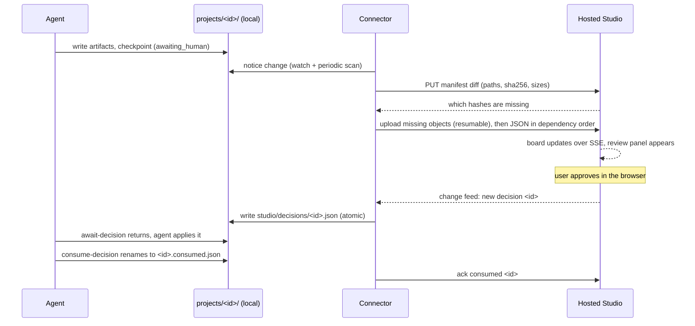

# `openmontage sync` — Sync Protocol

**Status:** specification only (Phase 7). Read it with `design.md` (system shape) and `../03-architecture.md` §3 (the disk contract it mirrors).

The connector runs on the user's machine next to the agent. It keeps the agent's working copy of `projects/<id>/` and the hosted Studio consistent. The agent and its tools never talk to the service; they keep reading and writing local files.

## 1. Principles

1. **One owner per file class.**
   - Agent-owned files are authoritative locally and only pushed.
   - Studio-owned files are authoritative on the server and only pulled.
   - No file class is edited on both sides, so there are no content merges.
2. **Decisions are immutable.** A decision file is never edited after creation. It can only be retracted (before the agent sees it) or consumed (by the agent, which renames it locally).
3. **Content-addressed transfers.** Every file is identified by SHA-256. Unchanged files are never re-sent, and an interrupted upload resumes from its last acknowledged part.
4. **Atomic visibility on both sides.**
   - Locally, the connector writes pulled files to a hidden `.partial-*` / `.*.tmp` name and renames them, as Studio does today.
   - On the server, an object becomes visible only when its upload completes.
5. **Secrets never leave the machine.** `.env` and any environment values are never read or sent.
6. **Partial or hidden files are never synced.** This covers names starting with `.` (temp files, `.partial-*`).

## 2. File classes

Paths are relative to `projects/<id>/` unless marked *(machine)*.

| # | Path pattern | Owner | Direction | Conflict rule | Notes |
|---|---|---|---|---|---|
| 1 | `project.json` | agent (`init_project`) | push | local wins | Created locally by the connector for Studio-created projects (§4.2), then owned by the agent. |
| 2 | `checkpoint_<stage>.json` | agent | push | local wins; the server keeps every pushed version in `history` | Push only after the artifacts it names (§3.4). |
| 3 | `history/checkpoint_*.json` | agent | push | append-only; same name and different hash is a protocol error, logged and skipped | |
| 4 | `artifacts/*.json` | agent | push | local wins | Includes `video_analysis_brief.json`, `render_report.json`, `publish_log.json`. |
| 5 | `decision_log.json` (root or `artifacts/`) | agent | push | local wins | Studio decisions show up here with `source: "studio"`. |
| 6 | `events.jsonl` | agent | push (append) | local wins; sent as byte ranges from the last acknowledged offset; a shrinking file is re-sent whole | Drives the live board. |
| 7 | `cost_log.json` | agent (`tools/cost_tracker.py`) | push | local wins | |
| 8 | `assets/**`, `snapshots/**`, `verify/**`, `renders/**`, root `*.mp4` / `*.mp3` | agent | push (media, resumable) | local wins | ffprobe facts and a poster thumbnail are sent with each video (`design.md` §3.3). |
| 9 | export folder or file named by `publish_log.entries[].export_path` | agent | push | local wins | Only paths inside the project. |
| 10 | `studio/intake.json` | Studio | pull | server wins; a differing local copy is replaced and the overwrite logged | The agent must not edit it (AGENT_GUIDE). |
| 11 | `studio/inputs.json` | Studio | pull | server wins | Index of uploads and references. |
| 12 | `inputs/**` | Studio (uploads) | pull | server wins; files are immutable once complete | A file the user drops into `inputs/` by hand is pushed as a new upload with `source: "device"`, then follows this rule. |
| 13 | `studio/decisions/<id>.json` | Studio | pull | immutable; never overwritten | Retraction and consumption are covered in §3.3. |
| 14 | `studio/decisions/<id>.consumed.json` | agent (`consume-decision`) | push as an *ack*, not a file | local wins | The server sets `decisions.consumed_at`. |
| 15 | *(machine)* `config.yaml`, allowlisted keys only (`backlot/studio_settings.py` `EDITABLE`) | Studio (Settings) | pull | server wins; a local hand-edit of an allowlisted key is reported back as a warning, not merged | Written with the same line-edit rules, so comments and other keys stay. |
| 16 | *(machine)* `music_library/**` | user | both | additive; same name and different hash keeps both (`name-2.ext`, as uploads do) | Mirrors the per-user `music/` prefix. |
| 17 | *(machine)* capability summary (`provider_menu_summary()`, runtimes) | device | push (report) | latest report wins | Contains no secrets: key *status* only (set / unset). |
| 18 | *(machine)* `.env`, environment | — | **never** | — | |

Any path not covered by a row (for example new tool caches) is **not synced** until a row is added here. That makes "new file class" a reviewed change.

## 3. Sequences

### 3.1 Pairing

1. `openmontage sync login` starts an OAuth device-code flow against the service.
2. The user approves the device in the browser (Studio → Account → Devices).
3. The service issues a device token: random, 256 bits, stored hashed, scoped to the user's tenant, revocable.
4. The connector stores it in the OS keychain, or in a `0600` file under the user's config directory.

### 3.2 Steady state

- **Change feed:** `GET /sync/v1/changes?cursor=<n>` is a long poll (or SSE) that returns the Studio-owned changes after the cursor: intakes, inputs, decisions, retractions, settings, music.
- **Push:**
  - `PUT /sync/v1/projects/<id>/manifest` returns the missing hashes.
  - Missing objects are uploaded through pre-signed multipart URLs; parts are 8 MB, and resumable uploads are keyed by SHA-256.
  - `POST /sync/v1/projects/<id>/commit` lists the paths that are now complete.
- **Cadence:**
  - The local watch is debounced 1 s, with a full rescan every 5 minutes.
  - The pull long poll is held 30 s.
  - Review points should reach the browser within a few seconds of the agent writing them.

### 3.3 Decisions

- **The server validates first.** When the user answers, the decision is validated against the *latest pushed* checkpoint (same rules as `backlot/studio_decisions.py`: `awaiting_human`, matching timestamp). It is then stored with a server signature: `HMAC(server_key, id|project|stage|checkpoint_timestamp|action|user_id)`.
- **Pull.** The connector writes it locally only if the local checkpoint still has that `checkpoint_timestamp`. Otherwise it reports `stale` back and never writes it. This mirrors local behaviour, where a stale decision is ignored.
- **Retract before pull:** the decision is never written locally.
- **Retract after pull, not yet consumed:** the connector deletes the local pending file. If the agent consumed it in the meantime, the retraction fails with `409 already_consumed`, as it does locally today.
- **Consume:** the connector sees the `.consumed.json` rename and acks. Consumption is final.
- **Signature check.** The connector refuses decision files whose signature does not verify, and reports `forbidden_device`. A file the user placed by hand still works locally, because `await-decision` reads files, but it is never pushed as a Studio decision.

### 3.4 Ordering

A JSON file is committed only after every object it references is committed:
- assets before `asset_manifest`;
- artifacts before the checkpoint that embeds or names them;
- renders before `render_report`.

The board therefore never shows a checkpoint whose artifacts are missing. Within one commit the order is media → artifacts → checkpoint → `events.jsonl` range.

## 4. Lifecycle

### 4.1 Projects created by the agent

The first push of an unknown project id creates the project row, owned by the device's user. The id is kept. A clash with an existing id in the same tenant is answered `409 sync_conflict`; the connector then appends `-2` locally and logs the rename.

### 4.2 Projects created in Studio

`POST /api/v1/projects` creates the row and the intake on the server. The connector pulls the new project and runs `lib.checkpoint.init_project(id, title, pipeline_type, style_playbook)` locally. It then writes `studio/intake.json` and `studio/inputs.json` and pulls `inputs/**`. The kickoff command shown in Studio is unchanged.

### 4.3 Deletes

Deleting a project in Studio soft-deletes it on the server. The connector moves the local folder to `projects/_trash/<id>-<date>/`, which `list_ids` skips and the store refuses to address (ids starting with `_` or `.` are invalid, `validate_project_id` in `backlot/project_store.py`), and never deletes local agent work outright. Local deletes of agent-owned files are pushed as tombstones; the server keeps the last version for 30 days.

### 4.4 Offline

The connector queues pushes on disk and resumes them. While it is offline:
- Studio shows the last synced state with an "offline since …" banner;
- decisions answered meanwhile are delivered on reconnect if still valid, otherwise reported stale.

## 5. Capability report

- **When:** every 10 minutes, after `openmontage keys set`, and when Studio asks for a re-check. The connector runs the same probe as `backlot/setup_probe.py`.
- **What it sends:** the summary (runtimes, configured capabilities, per-video-type coverage) and, per provider key, only `set: bool` and the last-4 hint already used locally (`backlot/studio_setup.py` `env_status`).
- **Use on the server:** the hosted Setup page and the wizard's lock states read the latest report of the user's most recently active device.

## 6. Security of the channel

- TLS only, with certificate validation. The device token is sent in the `Authorization` header.
- **Server-side checks on every request:**
  - the token's tenant owns the project;
  - paths are normalised and must stay inside the project (same rules as `ProjectFiles.safe_rel`);
  - hashes and sizes are verified on commit.
- **Local checks.** The connector applies the same path checks before writing anything it pulled. A pulled path that would leave `projects/<id>/` (or `music_library/`) is rejected and reported.
- Rate limits are per device. Repeated validation failures revoke the device and notify the user.
